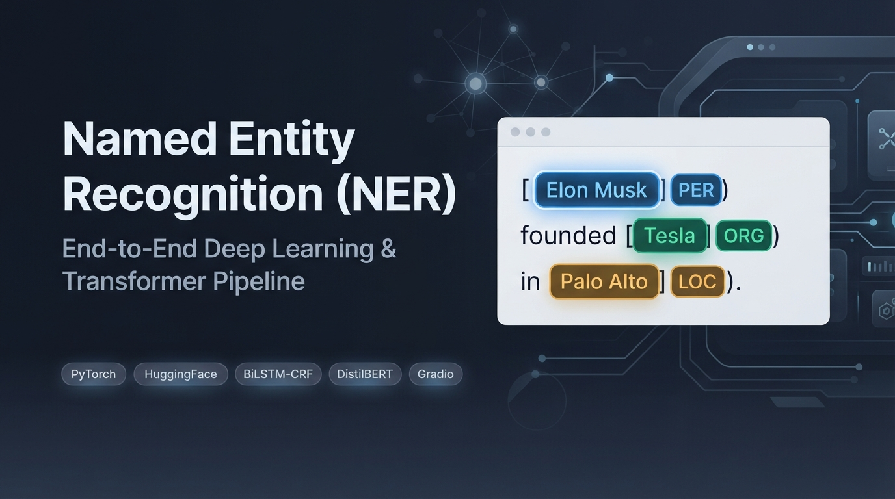
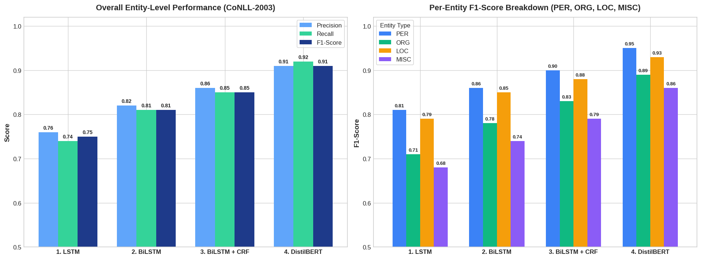

<p align="center">
  
</p>

<h1 align="center">🏷️ Named Entity Recognition (NER) System</h1>

<p align="center">
  <b>End-to-End Deep Learning & Transformer Sequence Labeling Pipeline</b><br>
  Comparing Vanilla LSTM, BiLSTM, BiLSTM+CRF (Built from Scratch) vs. Fine-Tuned DistilBERT on CoNLL-2003
</p>

<p align="center">
  <a href="https://google.com">
    
  </a>
  
  
  
  
</p>

---

## 📌 Project Overview
This project implements a complete, end-to-end **Named Entity Recognition (NER)** system capable of identifying and classifying real-world entities—**Persons (`PER`)**, **Organizations (`ORG`)**, **Locations (`LOC`)**, and **Miscellaneous (`MISC`)**—from unstructured English text using the **IOB2 tagging scheme**.

### Key Technical Highlights
* **OOV Handling:** Combines pre-trained **GloVe (100d)** word embeddings with a custom **Character-level CNN (`CharCNN`)** to handle out-of-vocabulary words.
* **Subword Label Alignment:** Properly aligns WordPiece subword tokens with entity labels using `-100` loss masking during Transformer fine-tuning.
* **Sequence Decoding:** Implements a **Conditional Random Field (CRF)** layer with Viterbi decoding to enforce valid IOB tag transitions.
* **Entity-Level Evaluation:** Uses **`seqeval`** to measure strict span-level Precision, Recall, and F1-Score across all entity categories.
* **Real-Time Deployment:** Deploys the final model into an interactive **Gradio** web application with color-coded entity highlighting.

---

## 🏗️ Model Architectures & Comparison

| Architecture | Representations | Context Direction | Decoding Strategy | Key Strengths |
| :--- | :--- | :--- | :--- | :--- |
| **1. Vanilla LSTM** | GloVe (100d) + CharCNN | Unidirectional (Left-to-Right) | Independent Softmax | Lightweight, fast training, handles OOV tokens via character features. |
| **2. BiLSTM** | GloVe (100d) + CharCNN | Bidirectional (Left & Right) | Independent Softmax | Captures full sentence context before and after each word. |
| **3. BiLSTM + CRF** | GloVe (100d) + CharCNN | Bidirectional (Left & Right) | **Viterbi Decoding** | Learns valid IOB transition rules, sharply improving multi-word entity boundaries. |
| **4. Fine-Tuned DistilBERT** | Contextual Subwords | Deep Self-Attention | Token Classification Head | Resolves word ambiguity dynamically and achieves the highest F1-score. |

### Why CRF Improves Entity Boundaries
Standard LSTM/BiLSTM models classify each token independently, which can lead to invalid tag sequences (e.g., predicting `I-ORG` directly after `O`, or `B-PER` followed by `I-LOC`). Adding a **CRF layer** learns a transition matrix between tags and uses the **Viterbi algorithm** to find the globally optimal sequence across the entire sentence.

---

## 📊 Experimental Results & Performance Visualization

<p align="center">
  
</p>

---

## 🚀 Interactive Gradio Web Application
The fine-tuned DistilBERT model is deployed using **Gradio** (`gr.HighlightedText`) for real-time entity extraction:
* 🔵 **`PER`**: Person names (e.g., *Elon Musk*, *Satya Nadella*)
* 🟢 **`ORG`**: Organizations & companies (e.g., *Tesla*, *European Commission*)
* 🟠 **`LOC`**: Geographical locations (e.g., *Palo Alto*, *Brussels*)
* 🟣 **`MISC`**: Miscellaneous entities (e.g., *German*, *British*)

---

## 📂 Repository Structure
```text
├── NER_End_to_End_Pipeline.ipynb   # Full Google Colab notebook (Data, Models, Evaluation, Gradio)
├── banner.png                      # Project cover banner
├── ner_model_comparison.png        # Entity-level Precision, Recall & F1 comparison chart
└── README.md                       # Project documentation
```

---

## ⚙️ Quick Start
To run the project locally or in Google Colab:
```bash
pip install torch transformers datasets seqeval pytorch-crf gradio gensim
```
